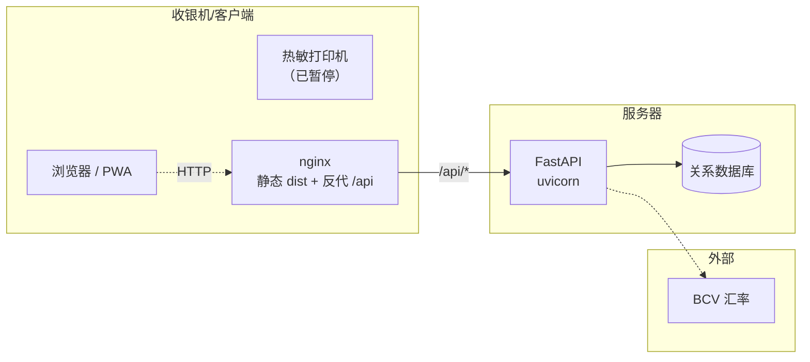
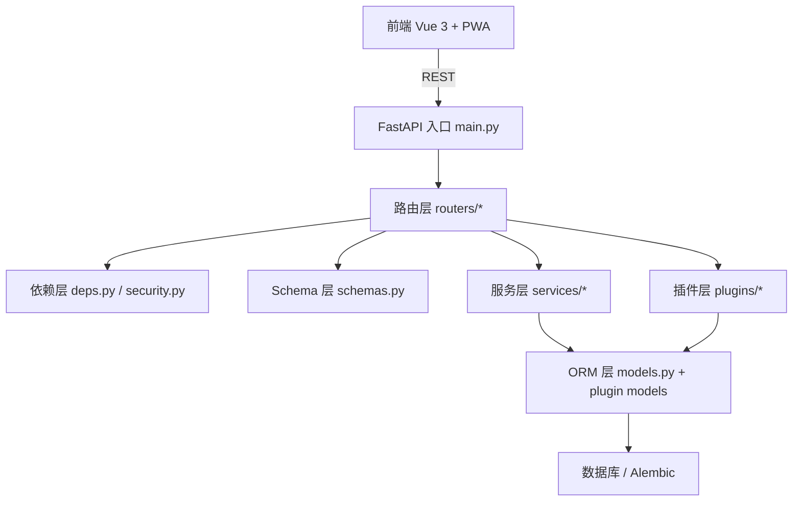
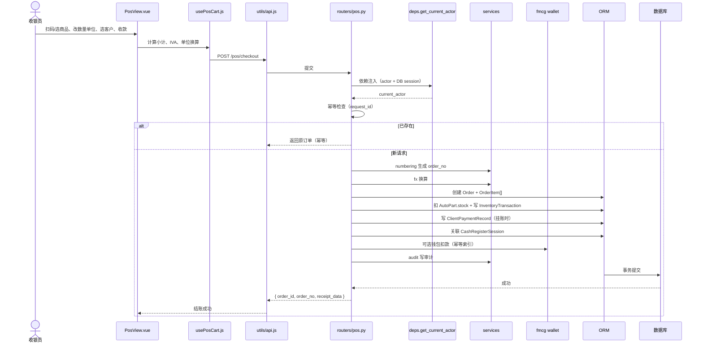
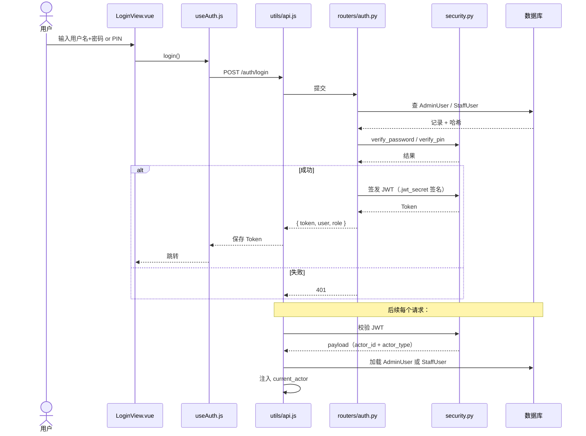
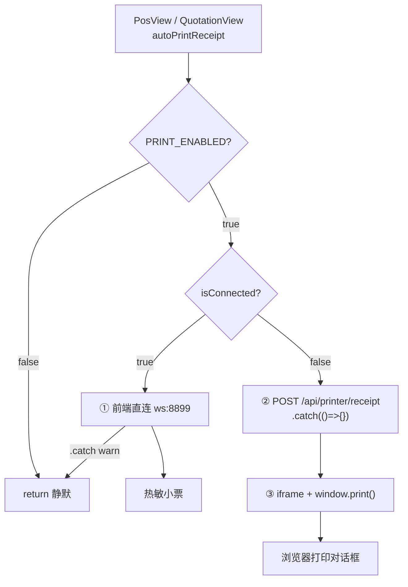
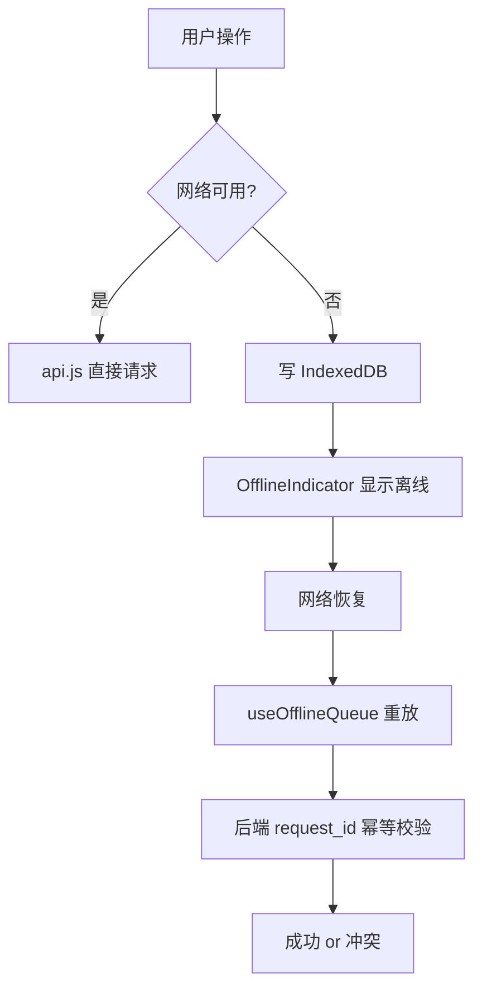

# TOSTIYK ERP 架构分析

> **生成日期**：2026-10-28
> **依据**：清理后的代码树 + `pytest` 53 passed + 前端 `npm run build` 通过 + `/api/printer` 已下线
> **配套文档**：`docs/architecture.md`（原作者视角）、`docs/e2e-baseline.md`（E2E 基线）
> **清理前基线**：`docs/repo-structure-baseline.txt`

---

## 0. 阅读前说明

- **本文范围**：`app/`、`frontend/src/`、`alembic/`、`tests/`、`scripts/`、部署配置。
  `frontend/dist/`、`*/node_modules/`、`.archive/` 为产物、依赖或归档，不在分析范围。
- **依据**：
  - 目录结构 + 打印代理源码（`agent.js`、`usePrintAgent.js`）+ 路由源码（`routers/printer.py`）
  - `app/models.py` 的类名与表名（SQLModel 结构，字段以业务推断标注）
  - `alembic/versions/` 文件名与迁移顺序
  - `pytest` 53 passed、`npm run build` 成功
- **未读取的部分**（`models.py` 字段细节、`main.py` 全文、`useOfflineQueue.js` 内部逻辑）
  以"🟡 推断"标注，待后续补充。
- **已有文档**：`docs/architecture.md`、`docs/e2e-baseline.md` 为项目内既有文档，本文作为补充，不替代。

---

## 1. 系统上下文

TOSTIYK ERP 是一套面向**委内瑞拉汽车配件零售/批发**场景的进销存系统，核心能力：

| 能力 | 说明 |
|---|---|
| POS 收银 | 多单位（箱/件）、多税率（IVA 0/8/16%）、混合支付、退款、离线补录 |
| 库存 | 汽配商品、多单位换算、成本价（USD）、盘点 |
| 采购 | 供应商、采购单、收货入库、供应商账期/付款 |
| 销售 | 报价单、报价转订单、客户应收 |
| 财务 | 交易流水、费用、报表、客户/供应商对账单 PDF |
| FMCG 插件 | 钱包账本（幂等），面向快消场景扩展 |
| 汇率 | BCV（委内瑞拉央行）汇率接入 |
| 运维 | 备份恢复、审计日志、工厂重置 |
| 打印 | 80mm 热敏小票，**2026-10-28 起暂停** |

**外部依赖：**
- 热敏打印机（通过 print-agent，已归档）
- BCV 汇率接口（`services/bcv.py`）
- 浏览器（PWA：Service Worker + IndexedDB 离线队列）

**地域性业务特征：**
- 委内瑞拉 IVA（0% / 8% / 16%）—— 小票打印硬编码
- BCV 汇率（USD ⇄ BS）—— `services/bcv.py`
- 西语 / 中文双语 UI

---

## 2. 部署拓扑



**部署形态待确认：**
- 生产是 Docker 单机、Docker 多机、还是裸机 + nginx？
- 决定 `frontend/dist/` 是否保留
- 原打印架构假设"后端与打印代理同机"（ws 只监听 127.0.0.1），但打印直连是**浏览器直连**，与后端部署无关——打印代理必须跑在**收银机本地**

---

## 3. 分层架构



### 职责划分

| 层 | 职责 | 不做什么 |
|---|---|---|
| 前端 | 页面交互、状态、离线队列、打印触发 | 不做权限最终判定 |
| 路由层 | HTTP 契约、参数校验、错误转换 | 不写复杂业务逻辑 |
| 依赖层 | 注入 DB Session、解析当前用户、权限校验 | 不处理业务 |
| Schema 层 | Pydantic 请求/响应模型，OpenAPI 契约 | 不含业务规则 |
| 服务层 | 可复用业务：备份、PDF、编号、汇率、审计、限流 | 不处理 HTTP |
| 插件层 | 行业扩展：`auto_parts`、`fmcg` | 不改核心表结构（通过独立迁移） |
| ORM 层 | 实体与关系（SQLModel） | 不含业务 |
| 迁移层 | 表结构演进（Alembic） | — |

**关键技术选型：**

- **SQLModel**（FastAPI 作者 tiangolo）：ORM + Pydantic 融合
- 路由使用 `dependencies=[Depends(get_current_actor)]` 做鉴权
- 插件有独立 `models.py` + `routers/` + `services/`（FMCG 完整三级）
- 服务层按能力分文件，粒度细，利于测试

---

## 4. 领域模型（ER 图）

### 4.1 技术栈

**SQLModel**：关系用 `Relationship()` + `back_populates`，外键用 `Field(foreign_key="...")`。

**命名风格不统一**（技术债）：`autopart`（小写无下划线）/ `suppliers`（复数）/ `orders`（复数）/ `system_settings`（蛇形复数）。

### 4.2 完整 ER 图

**图例：** 🔵 已由 `foreign_key=` 或 `cascade=` 确认 ｜ 🟡 推断待验证

```mermaid
erDiagram
  AutoPart {
    int id PK
    string name
    float cost_price_usd
    float stock
  }
  InventoryTransaction {
    int id PK
    int part_id FK
    float qty
  }
  AutoPart ||--o{ InventoryTransaction : "库存变动 🟡"
  AutoPart ||--o{ OrderItem : "被下单 🟡"

  Client {
    int id PK
    string name
    string store_name
  }
  ClientPaymentRecord {
    int id PK
    int client_id FK
    float amount
  }
  Client ||--o{ ClientPaymentRecord : "收款 🟡"
  Client ||--o{ Order : "下单 🟡"

  Supplier {
    int id PK
    string name UK
    string terms
  }
  SupplierPaymentRecord {
    int id PK
    int supplier_id FK
    float amount
  }
  Supplier ||--o{ SupplierPaymentRecord : "付款 🟡"
  Supplier ||--o{ PurchaseOrder : "供货 🟡"

  PurchaseOrder {
    int id PK
    int supplier_id FK
    string status
  }
  Note over PurchaseOrder: 明细表待确认

  Order {
    int id PK
    string order_no
    int client_id FK
    int staff_id FK
    int session_id FK
    string request_id UK
    float total_usd
  }
  OrderItem {
    int id PK
    int order_id FK
    int part_id FK
    int unit_id FK
    float qty
    float unit_price
    float tax_rate
    float cost_price_usd
  }
  Order ||--|{ OrderItem : "包含 🔵 cascade"
  Order }o--o| Client : "客户（散客可空）🟡"
  Order }o--|| StaffUser : "收银员 🟡"
  Order }o--|| CashRegisterSession : "归属班次 🟡"

  HeldOrder {
    int id PK
    int staff_id FK
    json payload
  }
  HeldOrder }o--|| StaffUser : "挂单操作员 🟡"

  CashRegisterSession {
    int id PK
    int staff_id FK
    string status
  }
  CashRegisterSession }o--|| StaffUser : "开班/关班 🟡"

  QuotationRecord {
    int id PK
    string quotation_no
    int client_id FK
    int converted_order_id FK
  }
  QuotationRecord }o--o| Client : "报价客户 🟡"
  QuotationRecord }o--o| Order : "报价转订单 🟡"

  Expense {
    int id PK
    float amount
    string category
  }

  AdminUser {
    int id PK
    string username UK
    string password_hash
  }
  StaffUser {
    int id PK
    string username UK
    string pin_hash
  }
  AuditLog {
    int id PK
    int actor_id FK
    string actor_type
    string action
  }
  AdminUser ||--o{ AuditLog : "操作 🟡"
  StaffUser ||--o{ AuditLog : "操作 🟡"

  SystemSettings {
    int id PK
    string key UK
    string value
  }

  ProductUnit {
    int id PK
    int product_id FK
    string name
    float factor
  }
  ProductPrice {
    int id PK
    int product_id FK
    int unit_id FK
    float price_usd
  }
  Wallet {
    int id PK
    int client_id FK
    float balance
  }
  WalletLedger {
    int id PK
    int wallet_id FK
    string request_id UK
    float amount
  }

  AutoPart ||--o{ ProductUnit : "多单位 🔵"
  AutoPart ||--o{ ProductPrice : "单位定价 🔵"
  ProductUnit ||--o{ ProductPrice : "单位级定价 🔵"
  Client ||--o| Wallet : "客户钱包 🔵"
  Wallet ||--o{ WalletLedger : "账本流水 🔵"
```

**确定性统计：** 🔵 6 条已确认 ｜ 🟡 11 条推断

### 4.3 实体分组

| 域 | 实体 |
|---|---|
| 商品与库存 | `AutoPart`、`InventoryTransaction` |
| 销售/POS | `Order`、`OrderItem`、`HeldOrder`、`CashRegisterSession` |
| 客户与应收 | `Client`、`ClientPaymentRecord` |
| 供应商与应付 | `Supplier`、`SupplierPaymentRecord` |
| 采购 | `PurchaseOrder`（**明细待确认**） |
| 报价 | `QuotationRecord` |
| 费用 | `Expense` |
| 用户与审计 | `AdminUser`、`StaffUser`、`AuditLog`（**双用户表**） |
| 系统 | `SystemSettings` |

### 4.4 FMCG 插件模型

| 实体 | 表 | 外键 | 用途 |
|---|---|---|---|
| `ProductUnit` | `fmcg_product_unit` | `product_id → autopart.id` | 多单位（箱/件/瓶） |
| `ProductPrice` | `fmcg_product_price` | `product_id → autopart.id`、`unit_id → fmcg_product_unit.id` | **按单位定价** |
| `Wallet` | `fmcg_wallet` | `client_id → client.id` | 客户预付/赊账钱包 |
| `WalletLedger` | `fmcg_wallet_ledger` | `wallet_id → fmcg_wallet.id` | 账本流水，**有独立幂等索引** |

**设计要点：**
1. **多单位与定价分离**：支持"同商品按箱/按件/按瓶不同价"
2. **钱包与客户 1:1**：`client_id` 唯一外键，每客户一个钱包
3. **账本幂等**：`WalletLedger.request_id` 唯一索引（迁移 `f32ccd095e90`），与 POS 订单幂等形成**两级幂等**

### 4.5 三大未决问题

| 问题 | 影响 |
|---|---|
| `PurchaseOrder` 明细在哪？复用 `OrderItem` 还是独立表/JSON？ | ER 图无法画全采购链 |
| `AuditLog` 如何关联两类用户？`admin_id`/`staff_id` 双 FK 还是 `actor_type`？ | 审计追溯完整性 |
| `HeldOrder.payload` 是 JSON 还是结构化关系？ | 挂单恢复时的数据完整性 |

---

## 5. 核心业务流程

### 5.1 POS 结账流程



**幂等设计（迁移确认）：**
- `c3e5f7a9b1d2_pos_batch3_request_id` 引入 `request_id`
- 前端每次结账生成 UUID，网络失败入 IndexedDB 队列，恢复后重放
- 后端按 `request_id` 查重 → 已存在返回原结果
- **两级幂等**：订单幂等 + 钱包账本幂等（`f32ccd095e90`）

**涉及表：** `orders`、`order_items`、`autopart`（UPDATE）、`inventorytransaction`、`clientpaymentrecord`、`cashregistersession`、`auditlog`、`fmcg_wallet_ledger`（可选）

**待确认：**
- 事务边界：`commit` 在路由还是服务层？
- 库存不足：拒绝整单 or 允许负库存？
- 退款流程：`refund_type` 是否独立路由？
- `HeldOrder`（挂单）：挂单时扣库存否？取单时重新校验？
- `CashRegisterSession`：跨班次如何结算？

### 5.2 认证与权限

**双用户表：**
- `AdminUser`（管理员）
- `StaffUser`（员工/收银员）
- **分表设计，不是角色字段**



**权限边界：**
- **后端唯一权威**：`dependencies=[Depends(get_current_actor)]`（`routers/printer.py` 已确认）
- **前端仅 UX**：`usePermissions.js`、`PinOverrideModal.vue`（经理 PIN 二次授权）

**相关文件：** `models.py:260` `AdminUser`、`models.py:270` `StaffUser`、`security.py`、`deps.py`、`routers/auth.py`、`useAuth.js`、`usePermissions.js`、`PinOverrideModal.vue`

**待确认：**
- `AuditLog` 如何关联两类用户？
- `StaffUser` 是否有 `role` 字段？
- JWT 有效期？refresh token？
- PIN 是快捷登录还是二次授权？

### 5.3 打印链路（⚠️ 2026-10-28 起暂停）

> **状态**：print-agent 归档至 `.archive/print-agent/`，后端路由注释，前端 `PRINT_ENABLED = false`。
> `/api/printer/*` 返回 404，OpenAPI 已无该路径。

**三级降级链，与订单事务完全解耦**（`app/routers/pos.py` 中无 print 调用）：



| 优先级 | 路径 | 前提 | 备注 |
|---|---|---|---|
| ① | 浏览器 → `ws://127.0.0.1:8899` → agent | `isConnected` | **主路径** |
| ② | 浏览器 → `/api/printer/receipt` → services → ws | ① 未连 | **冗余** |
| ③ | iframe + `window.print()` | 无论 ② 成败**都执行** | 弹系统对话框 |

**关键事实：**
1. **① 失败不降级**（只 warn），避免误开 A4 对话框
2. **②③ 并行**（② `await` 后无论成败执行 ③）
3. **② 是历史遗留**（后端服务再连一次 ws，功能与 ① 重复）
4. **订单-打印解耦**（`PosView.vue:1697` 注释明确）

**停用改动清单：**

| 文件 | 改动 |
|---|---|
| `app/main.py:56` | `# from app.routers import printer` |
| `app/main.py:165` | `# app.include_router(printer.router)` |
| `frontend/src/composables/usePrintAgent.js` | 新增 `export const PRINT_ENABLED = false` + 2 处早返回 |
| `frontend/src/components/PosView.vue:753,2011` | import + 早返回 |
| `frontend/src/components/QuotationView.vue:301,601` | import + 早返回 |
| `print-agent/` → `.archive/print-agent/` | 归档 + tar 备份 `~/tostiyk-print-agent-backup-*.tar.gz` |

**恢复步骤：**
1. `.archive/print-agent/` 移回 `print-agent/`
2. `app/main.py` 第 56、165 行取消注释
3. `usePrintAgent.js` 中 `PRINT_ENABLED = true`
4. `PosView.vue` 和 `QuotationView.vue` 各移除 1 行早返回
5. **建议同时**：
   - 删除 ② 冗余路径
   - `agent.js` 硬编码外置到 `config.json`
   - Windows 用 `windows/agent-win.js`

### 5.4 离线队列（🟡 待补充源码）

由目录 + E2E 测试推断：

- `frontend/src/offline/db.js`：IndexedDB 存储
- `frontend/src/composables/useOfflineQueue.js`：重放逻辑
- `frontend/src/components/OfflineIndicator.vue`：UI 状态
- E2E：`offline-queue.spec.js`、`offline-enqueue-api.spec.js`、`pos-offline.spec.js`、`offline-indicator.spec.js`

**推断流程：**



**待补充**：`useOfflineQueue.js` 的 API 签名、失败重试策略、冲突解决。

---

## 6. 演进痕迹

### 6.1 POS 三批迭代

| 批次 | 迁移 | 说明 |
|---|---|---|
| 初始 | `082a363b8b44_initial` | 建表 |
| POS-1 | `9f3c1a7b2d4e_pos_batch1_unique_partid_shift` | 唯一约束 |
| POS-2 | `b7d2e4f6a8c1_pos_batch2_clientid_refund_type` | 客户 ID + 退款类型 |
| POS-3 | `c3e5f7a9b1d2_pos_batch3_request_id` | **request_id 幂等** |
| 后续 | `6e5a743c6889_pos_order_items_multi_unit` | 明细多单位 |
| 后续 | `4136d0a0c9ac_add_cost_price_usd_to_orderitem` | 明细成本价 USD |

**意图：** 起初只考虑"一次下单"，出现"重复提交/离线重放"后补 `request_id`。场景从"单件零售"演进到"箱/件混合 + 外币核算"。

### 6.2 供应商模块演进

| 迁移 | 说明 |
|---|---|
| `2abce90f8fce_add_supplier_payment_table` | 付款表 |
| `b1c2d3e4f5a6_supplier_terms_credit` | 账期/信用 |
| `092e79bcf78e_suppliers_make_ix_suppliers_name_unique` | 名称唯一 |
| `a1b2c3d4e5f6_supplier_payment_record_fk_datetime` | 修正 FK/时间戳 |

**意图：** "能付款"→"能欠款"→"防重复录入"→"修正数据模型缺陷"。

### 6.3 FMCG 插件重构

- 曾存在 `19131669ba8a_fmcg_plugin_v1`（pyc 残留），但 `.py` 已不在磁盘
- 当前生效的是 `0677f603ba8d_fmcg_plugin_v1`
- 后续 `f32ccd095e90_fmcg_ledger_idempotency_index` 补幂等索引

**待确认：** `19131669` 是否在任何环境执行过？若执行过需反向迁移脚本。

### 6.4 目录考古（2026-10-28 清理时确认）

| 发现 | 证据 | 结论 |
|---|---|---|
| `staff` 路由消失 | `staff.py` 不存在，`grep staff` 无命中，曾有 pyc | 合并进 `auth.py` / `deps.py`（已清 pyc） |
| `frontend/app/plugins/*` 空目录 | `total 0`，无引用 | 未完成的前端目录迁移（已清） |
| 6 个"修复/翻译"脚本 | `grep` 全无引用 | 一次性工具（已清） |
| `PartsView.vue.bak` | `grep` 无命中 | 编辑遗留（已清） |

### 6.5 待观察的技术债

- `app/main.py:203` `@app.on_event("startup")` 已弃用，应迁 `lifespan`
- `starlette.testclient` 对 `httpx` 适配已弃用（pytest 告警）
- `models.py` 表命名风格不统一
- `agent.js` 硬编码（打印机名、默认汇率、公司信息）

---

## 7. 待确认清单

### 7.1 安全（已完成）

- [x] `.env` / `.jwt_secret` / `*.pem` **从未进入 git 历史**（`git log --all` 验证为空）
- [x] 无需轮换密钥或重签证书
- [x] 敏感文件已加入 `.gitignore`

**遗留：**
- [ ] `.env.bak.20261027-202746` 谁生成的？建议查明后删除
- [ ] `.jwt_secret` 是否应由环境变量提供，而非文件？
- [ ] `scripts/factory_reset.py` 是否有二次确认？

### 7.2 架构

- [ ] 生产部署形态：Docker 单机 / 多机 / 裸机？
- [ ] `agent.js` 的 `cancel -a` 会取消该打印机全部任务，是否误伤其他打印？
- [ ] `services/printer.py` 是否有 WebSocket 超时 + 重试？

### 7.3 业务规则

- [ ] `agent.js` 默认汇率兜底 `887.00`，静默使用是否合理？
- [ ] 默认公司信息 `MUNDO REPUESTOS C.A` 是演示值还是真实？
- [ ] `scripts/audit_supplier_debt.py` 是一次性还是常规？
- [ ] `scripts/migrate_history_data.py` 是否已执行完？

### 7.4 数据与运维

- [ ] `backups/`、`uploads/` 是否有保留周期？
- [ ] `frontend/translations_*.json` 是否还在用？
- [ ] `STHeiti Light.ttc` 字体许可证是否允许商用分发？

### 7.5 插件

- [ ] FMCG 旧迁移 `19131669ba8a` 是否执行过？

### 7.6 文档

- [ ] `docs/architecture.md:360` "print-agent 是独立 Node.js 服务（非前端）"表述需修正为"被浏览器前端直接通过 WebSocket 调用"

---

## 8. 清理后目录基线

### 8.1 顶层结构

```
tostiyk-erp/
├── app/                      # 后端 FastAPI
├── alembic/                  # 数据库迁移
├── frontend/                 # Vue 3 前端
├── tests/                    # Pytest 单元测试
├── scripts/                  # 运维/迁移/审计脚本
├── docs/                     # 文档
├── .archive/                 # 归档（gitignore）
│   └── print-agent/          # 打印代理（2026-10-28 归档）
├── .env                      # 环境变量（gitignore）
├── .jwt_secret               # JWT 密钥（gitignore）
├── .gitignore
├── pytest.ini                # pytest 配置
├── requirements.txt
├── Dockerfile
├── docker-compose.yml
├── start.sh / stop.sh
└── main.py
```

### 8.2 后端 `app/`

```
app/
├── main.py                   # FastAPI 入口、路由注册、启动检查
├── config.py                 # 环境变量与配置
├── database.py               # DB 引擎、Session、Base
├── models.py                 # SQLModel 核心实体（17 个）
├── schemas.py                # Pydantic DTO
├── deps.py                   # 依赖注入
├── security.py               # 哈希、JWT
├── startup_checks.py         # 启动校验
├── routers/                  # 15 个路由模块
│   ├── auth.py  pos.py  parts.py  clients.py
│   ├── transactions.py  purchase_orders.py
│   ├── quotations.py  expenses.py  reports.py
│   ├── exports.py  backup.py  settings.py
│   ├── audit_logs.py
│   └── printer.py            # 已注释注册
├── services/                 # 12 个服务
│   ├── printer.py  backup.py  numbering.py
│   ├── fx.py  bcv.py  audit.py
│   ├── ratelimit.py  housekeeping.py
│   ├── config_service.py
│   ├── quotation_pdf.py
│   ├── client_statement_pdf.py
│   └── supplier_statement_pdf.py
└── plugins/
    ├── base.py  registry.py
    ├── auto_parts/
    └── fmcg/
        ├── models.py         # ProductUnit/ProductPrice/Wallet/WalletLedger
        ├── routers/wallet.py
        ├── services/{wallet,unit,exceptions}.py
        └── plugin.py
```

### 8.3 前端 `frontend/src/`

```
frontend/src/
├── main.js  App.vue
├── utils/{api,download}.js
├── composables/              # 20 个组合式逻辑
│   ├── useAuth.js  usePermissions.js
│   ├── usePosCart.js  usePrintAgent.js（含开关）
│   ├── useOfflineQueue.js
│   ├── useInventory.js  useClientActions.js
│   ├── usePartActions.js  useTxActions.js
│   ├── useExports.js  useGallery.js
│   ├── useI18n.js  useNotifications.js
│   ├── usePlugins.js  useSwipeBack.js
│   └── useTheme.js  useClock.js
├── components/               # 20+ 视图组件
│   ├── PosView.vue  DashboardView.vue
│   ├── PartsView.vue  ClientsView.vue  SuppliersView.vue
│   ├── TransactionsView.vue  FinancialView.vue
│   ├── ProcurementCenterView.vue
│   ├── QuotationView.vue  QuotationListView.vue
│   ├── BackupView.vue  AuditLogsView.vue  InventoryAuditView.vue
│   ├── StaffManagementView.vue  CashRegisterView.vue
│   ├── FmcgWalletView.vue  GastosView.vue
│   ├── LoginView.vue  PinOverrideModal.vue
│   ├── Sidebar.vue  SideDrawer.vue  ThemeSwitcher.vue
│   └── ...
├── mobile/                   # 8 个移动端视图
├── offline/db.js             # IndexedDB
└── plugins/registry.js
```

### 8.4 清理清单（2026-10-28）

**已删除：**

| 类别 | 文件 |
|---|---|
| 一次性脚本 | `frontend/{ultimate_safe_inject,fix_remaining,fix_vue_errors,auto_translate,safe_translate_batch1,fix_tests}.py` |
| 编辑遗留 | `frontend/src/components/PartsView.vue.bak` |
| 空目录 | `frontend/app/`（含空 `plugins/fmcg`、`plugins/auto_parts`） |
| 字节码 | `**/__pycache__/`、`**/*.pyc` |
| 测试产物 | `frontend/playwright-report/`、`frontend/test-results/`、`test-results/` |
| 临时文件 | `tree.txt` |
| 证书 | `frontend/key.pem`、`frontend/cert.pem`（`vite.config.js` `https: false`） |
| 归档 | `print-agent/` → `.archive/print-agent/` |

**`.gitignore` 完整内容：**

```gitignore
# Python
__pycache__/
*.py[cod]
.pytest_cache/
.venv/
venv/

# Node
node_modules/
frontend/dist/
frontend/playwright-report/
frontend/test-results/

# 证书与密钥
*.pem
*.key

# 本地数据库/日志
*.db
*.sqlite3
*.log

# 临时文件
print_temp.bin
tree.txt

# 敏感文件
.env
.env.*
!.env.example
.jwt_secret
*.secret

# 运行时数据
backups/
uploads/
.archive/

# macOS / IDE
.DS_Store
**/.DS_Store
.vscode/
```

**安全审计结果：** ✅ 敏感文件从未进入 git 历史，无需轮换。